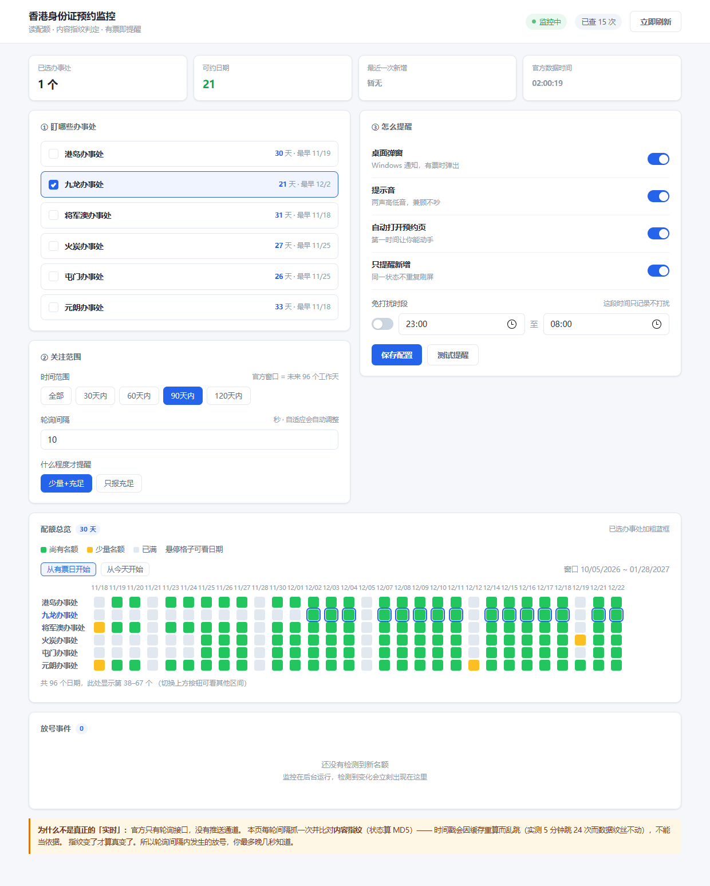
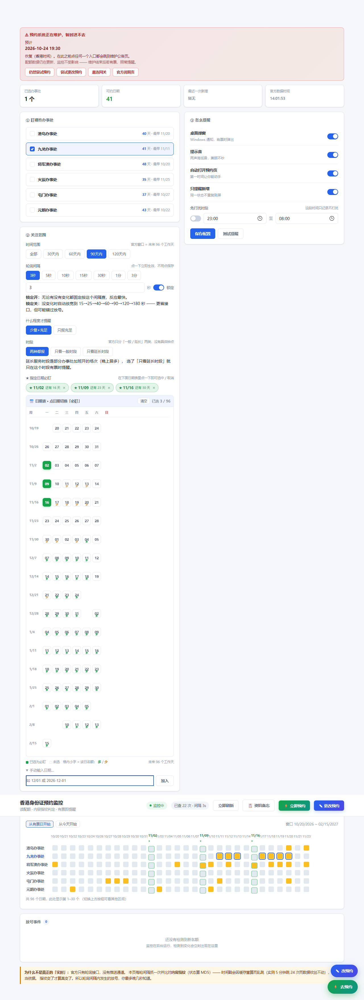
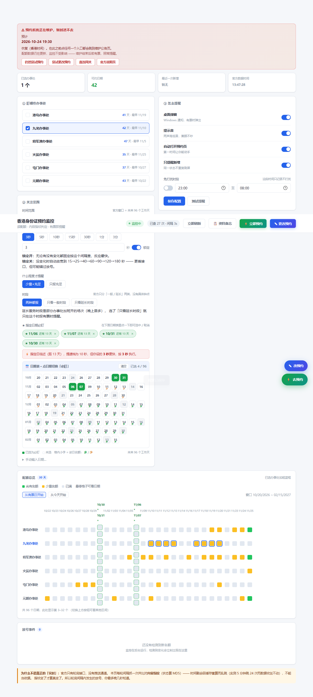
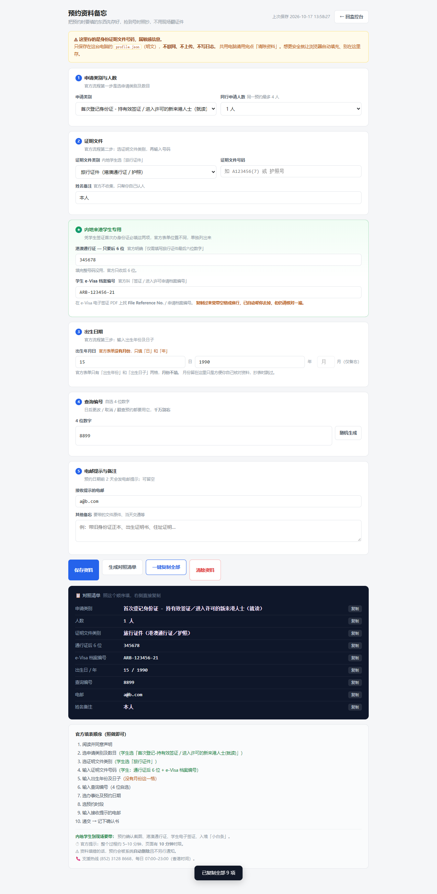
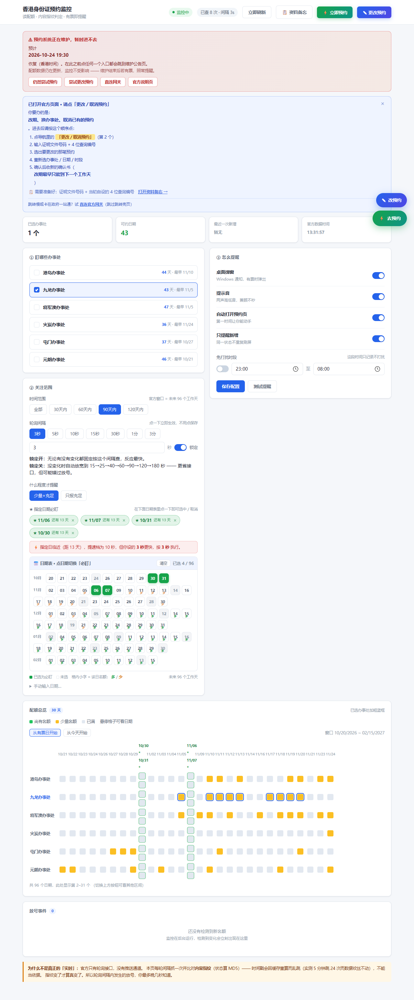
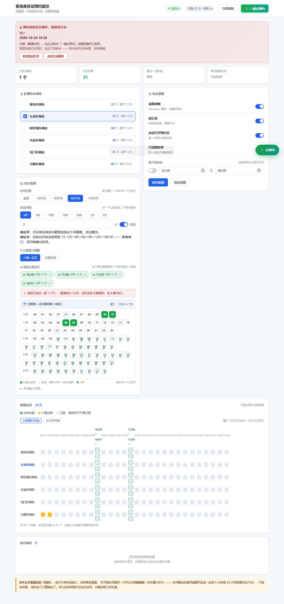

# HKID Booking Watcher · 香港身份证预约放号监控

盯住入境处身份证预约的名额变化，**在放号那一刻第一时间提醒你**，并顺手把预约要填的资料先存好。

数据来自官方「各人事登记办事处预约配额预览」的公开接口 —— 和你打开
<https://www.gov.hk/sc/apps/bookidcardquota.htm> 看到的完全同一份。



> ### ⚠️ 先说清楚这是什么、不是什么
>
> **这是只读监控工具，不会替你提交预约。**
>
> 官方预约流程含图形验证码（`captcha_4_0_beta_3_5/captchaValidate`），且
> 递交接口需要 surge-control 票据。入境处明确规定：
> *「申請人如以電腦程式或自動化工具干擾系統的正常運作或進行預約，即作不當使用系統論，
> 入境處可即時封鎖申請人使用系統的權限，無須預先通知。」*
>
> 所以本项目**主动放弃自动提交**，只做三件事：
> ① 高频读取公开配额 ② 变化时提醒你 ③ 帮你备好资料，让你几秒内自己填完。
> 抢位这件事，人到场手动做，比任何脚本都稳。

---

## 功能

| 模块 | 说明 |
|---|---|
| **可视化控制台** | 本机网页，可视化配置盯哪个办事处、什么范围、怎么提醒；六处 × 96 天配额热力图 |
| **内容指纹判定** | 不靠时间戳，靠数据内容算 MD5 判断「真的变了」 |
| **指定日期必盯** | 点日期表锁定目标日期，无视时间范围与门槛，越临近轮询越密 |
| **时段维度** | 区分「一般服务时段」与「延长服务时段」，可只看其中一种 |
| **预约资料备忘** | 本地保存填表所需资料，含内地学生专用区块，一键复制对照填 |
| **两种官方入口** | 「立即预约」与「更改预约」两个入口 + 站内操作指引 |
| **维护检测** | 自动识别系统维护并解析预计恢复时间，显示横幅 |
| **桌面提醒** | 原生弹窗 + 提示音，附 `FindWindowW` 可见性验证 |

---

## 快速开始

只需要 Python 3.9+，**零第三方依赖**（全部标准库）。

```bash
cd C:\Users\zheng\hkid-watch

# 启动可视化控制台（推荐）
python console.py
# → http://127.0.0.1:8770
```

打开后：
1. ① 选办事处（可多选）
2. ② 设时间范围 / 轮询间隔 / 提醒门槛 / 时段
3. ★ 在日期表上点你想死盯的日子
4. ③ 打开桌面弹窗与提示音，点「测试提醒」确认能看到听到
5. 点「保存配置」——大部分开关点一下即生效，无需保存

### 其它入口

```bash
# 命令行版：只看九龙，实时打印
python live_kowloon.py

# 时段感知版：按实测放号窗口自动调频（08:45-12:30 每 10 秒）
python smart_watch.py --office 九龙

# 单次查询打印表格
python hkid_watch.py --office 九龙
```

### 开机自启（可选）

```powershell
powershell -File setup_task.ps1
```

> **路径必须是纯 ASCII**。含中文的路径会被 `Register-ScheduledTask` 写成乱码
> （「杂事」→ U+93C9 U+5089），任务显示 Ready 但执行找不到脚本。
> `setup_task.ps1` 内含正则自检防这个问题。

---

## 放号时间：12 小时 / 2108 次探测的实测结论

```
  时段   事件数   新增   减少   净变化
  02:00      1      0      1      -1
  08:00      1      0      1      -1
  09:00      6    100     48     +52   ██████████████████████████████
  10:00      7     14     47     -33
  11:00      8     86     74     +12
  12:00      3      0     21     -21

  最大单次放号：09:31:37  +71
  最长静默：02:15 → 08:32  连续 6.3 小时零变化
```

**结论：放号集中在上午 9–12 点，不是零点。** 200 个新增名额 93% 落在
09:00–11:59；两次大放号在 **09:31（+71）** 和 **11:32（+48）**，间隔约 2 小时。
00:00–08:00 几乎完全静默。

**放号后是拉锯战**：09:31 那 71 个名额在随后 20 分钟内被反复抢占又释放
（+12/-12、+6/-6 交替），是有人抢、有人退的实时博弈，要盯紧。

| 时段 | 建议 |
|---|---|
| **08:45–12:30** | 重点盯，**10 秒**一次 |
| 12:30–23:00 | 低频即可，基本只有取消释放 |
| 23:00–08:45 | 极低频或休息 |

> ⚠️ 样本只有一天，不足以断言每天固定如此。推测跟随办公时间
> （9:30 / 11:30 类似上班节奏），但**请自己持续观察验证**。
> 之前设的「每天 00:10 守 45 分钟」是完全打错的时段。

---

## 界面预览

**指定日期必盯** —— 在 96 天日期表上点选，格内小字表示当天名额（多/少）



**时段维度** —— 区分一般服务时段与延长服务时段



**预约资料备忘** —— 本地保存，含内地学生专用区块



**两种官方入口 + 站内操作指引**



**系统维护检测**



---

## 技术要点

### 为什么必须用「内容指纹」

接口返回的 `lastUpdateTime` **不能作为放号信号**。实测它在一次放号期间会在
`09:31:30 / 09:31:53 / 09:32:01 / 09:32:28` 之间来回跳（差值达 58 秒），
是缓存节点不一致造成的 —— 5 分钟内跳了 24 次而数据纹丝不动。

所以判定「真的变了」的唯一可靠方法：把状态数据拼接后算 MD5，**指纹变了才算变**。

### 时段维度

接口的 `col` 是 `["date", "quotaR", "quotaK"]`：

- `quotaR` = 一般服务时段（General Service Hours）
- `quotaK` = 延长服务时段（Extended Service Hours），`no-quotaK` = 当天不设

**把两者合并取 max 会漏报**：某天 `quotaR` 本就是 `quota-g`、`quotaK` 从
`no-quotaK` 变成 `quota-g` 时，max 不变 → 指纹不变 → 永远不提醒。
因此指纹必须把两个时段都算进去，检测也要逐时段比较。

> 接口**没有具体钟点**（几点几分）。具体时段要进预约流程选完日期才显示，
> 需要票据 + 验证码，脚本拿不到。能到的最细粒度就是「一般 / 延长」。

### 官方入口的真实结构
```
https://www.gov.hk/sc/apps/immdicbooking2.htm      ← 官方对外入口（跳转壳页）
  └─ 加载 immdicbooking2.js，只有一句：
     redirect_to("https://entry.es2.immd.gov.hk/surgecontrol_extend/ticket/
                  getTicketGet?svcId=57A&language=zh&country=CN", 0)
```

**注意**：站内的 `makeAppointment` / `ropChangeCancelAppointment` 等功能页
**必须带 ticket**，直接访问一律渲染「错误代码 当前页面找不到」。
所以「预约 / 更改预约」两个按钮都走同一个网关，靠操作指引告诉用户点哪个菜单。

### 为什么提醒要弹 MessageBox

Win10/11 对**未注册 AUMID** 的 toast 会**静默丢弃**：`Show()` 正常返回、
代码打出 `TOAST_OK`，但屏幕上什么都不出现。「调用没报错」≠「用户看到了」。

所以主通道改成 `MessageBoxTimeoutW`（纯 Win32，真窗口，不依赖通知中心 /
AppID / 专注助手），并用 `FindWindowW` **轮询探测窗口句柄是否真的出现**，
探测到才算成功。

---

## 配置说明

`config.json`（控制台会自动生成；也可复制 `config.example.json` 修改）

| 字段 | 说明 |
|---|---|
| `offices` | 盯哪些办事处：`RHK` 港岛 / `RKO` 九龙 / `RTK` 将军澳 / `FTO` 火炭 / `TMO` 屯门 / `YLO` 元朗 |
| `within_days` | 只看未来 N 天，`0` = 全部（官方窗口 96 个工作天） |
| `min_state` | `2` = 少量名额也报，`3` = 只报充足 |
| `focus_dates` | 指定日期必盯，`MM/DD/YYYY`，无视上面两项且越近越密 |
| `service_hours` | `any` 两种时段都报 / `regular` 只看一般 / `extended` 只看延长 |
| `interval` | 轮询间隔秒数 |
| `fixed_interval` | `true` 锁死不退避；`false` 无变化时放宽到 180s |
| `notify.desktop` | 桌面弹窗 |
| `notify.sound` | 提示音 |
| `notify.open_browser` | 有票自动打开预约页 |
| `quiet_hours` | 免打扰时段（只记录不打扰） |

轮询间隔的实际取值优先级：**指定日提速 > 固定锁定 > 自适应退避**。
指定日提速只往快里压，绝不会把你自己设的更快间隔拖慢。

---

## 隐私

| 文件 | 内容 | 是否提交 |
|---|---|---|
| `profile.json` | 预约资料备忘（证件号、e-Visa 编号） | ❌ **已 gitignore** |
| `config.json` | 你的办事处/间隔/指定日期 | ❌ 已 gitignore |
| `logs/` | 探测日志、放号历史 | ❌ 已 gitignore |

`profile.json` **明文存本机，不联网、不上传、日志绝不记录内容**。
共用电脑请用完点「清除资料」。想更稳妥就让浏览器自动填充，别在这存证件号。

---

## 已知限制

- **维护期间进不去预约页**（配额接口仍会更新，所以监控不受影响）
- **只有「一般 / 延长」两个时段**，没有具体钟点
- **轮询不是推送**：官方无 WebSocket/SSE，轮询间隔内发生的放号最多晚几秒知道
- **不自动提交**：见开头说明，这是有意为之
- **放号规律样本不足**：一天数据不能当定论

---

## 目录结构

```
hkid-watch/
├── console.py          # 控制台后端（HTTP + 监控线程）
├── console.html        # 控制台前端（零依赖原生 JS）
├── profile.html        # 预约资料备忘页
├── hkid_watch.py       # 核心：接口拉取 / 解析 / 指纹 / 表格
├── notify.py           # 提醒：MessageBox + 系统提示音 + 可见性验证
├── smart_watch.py      # 时段感知监控
├── live_kowloon.py     # 九龙专用实时盯号
├── hkid_sniper.py      # 早期版本（保留参考）
├── analyze_probe_log.py    # 探针日志分析：按小时放号分布
├── fingerprint_probe.py    # 内容指纹长跑探针
├── probe_refresh*.py       # 刷新频率探测
├── test_watch.py       # 打真实接口的测试
├── setup_task.ps1      # 计划任务安装（含 ASCII 路径自检）
├── config.example.json # 配置模板
└── docs/               # 界面截图
```

---

## 免责

本项目仅做公开数据的只读查询与本地提醒，不修改、不提交、不绕过任何验证机制。
请遵守入境处服务条款，把自动化工具用于「及时知道自己该动手了」，
而不是替代你在官方系统里的操作。
